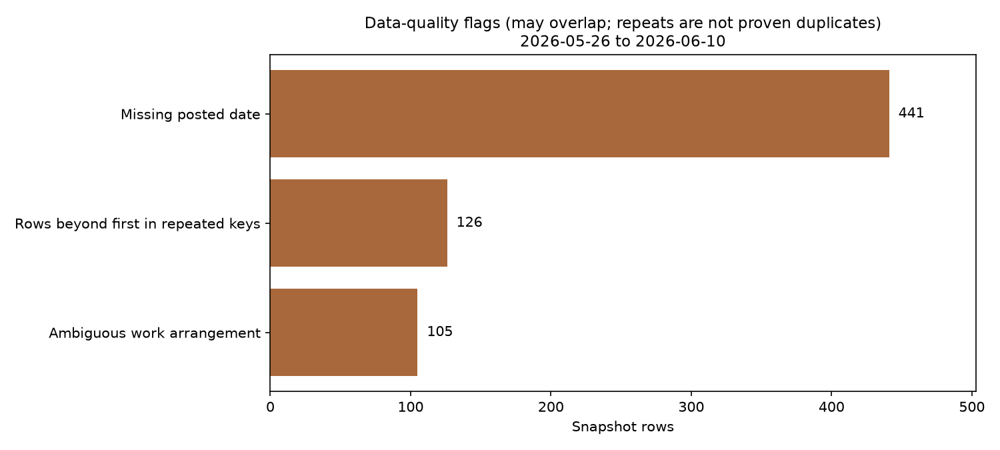

# UK job-posting snapshot: analysis and quality checks

I collected this sample while looking for work and wanted to understand which roles appeared in my feed. The first version put too much weight on posting counts and model-generated fit scores. This version checks the data first and draws a narrower conclusion.

**Scope:** 519 records first seen from 2026-05-26 to 2026-06-10. This is a dated case study, not a current vacancy list or a representative survey of the UK market.



## Key findings

- Data Analyst has 119 classified rows, compared with 69 for Data Scientist. Other has 142 rows, so it is important not to call DA the largest category overall.
- 441 posting dates are missing (84.97%). First seen is a collection timestamp, not a substitute for the posting date.
- 105 groups repeat the same source, title, company and location. There are 126 rows beyond the first in those groups. These might be duplicates, reposts or separate openings; I have not silently removed them.
- 113 rows explicitly say hybrid or remote (21.77%). Another 105 have mixed arrangements. Treating those as flexible produces 42.0%, which explains why the earlier figure was too broad for a practical job search.
- 121 rows have historical model scores of at least 70. That describes an uncalibrated scoring system, not the number of jobs I could realistically obtain.

## What I conclude

DA is worth investigating, but these data do not establish the easiest entry route, the cause of unsuccessful applications or the right application volume. I would check actual requirements and practical arrangements, then track interview outcomes before changing strategy. Agency adverts are not automatically invalid.

The useful result is a clearer description of the feed and a list of checks needed before using it to make decisions.

## Reproduce locally

Use Python 3.12. The lock file pins package versions and hashes, with platform markers for macOS and Linux. Run from the repository root:

```bash
python3.12 -m venv .venv
source .venv/bin/activate
python -m pip install --require-hashes -r requirements.lock
python -m unittest discover -s tests -v
python -m src.analyse --figures figures
python -m src.write_report
python -m src.build_notebook
python -m ipykernel install --sys-prefix --name job-market-python
python -m nbconvert --to notebook --execute notebooks/market_eda.ipynb --inplace --ExecutePreprocessor.kernel_name=job-market-python --ExecutePreprocessor.timeout=180
```

The analysis uses the supplied CSV. It does not scrape, call an LLM, send messages or require private credentials. To resolve dependencies again, use `uv pip compile requirements.in --python-version 3.12 --universal --generate-hashes --output-file requirements.lock` and review the changes.

## Explore the work

- [Executed notebook](notebooks/market_eda.ipynb)
- [Short decision memo](reports/market-memo.md)
- [Computed metrics](reports/generated/metrics.json)
- [Quality summary](reports/generated/quality-summary.md)
- [Potential repeated records](reports/generated/potential_repeated_groups.csv)
- [Methodology and data dictionary](docs/methodology.md)
- [Validation tests](tests/test_analysis.py)

`src/analysis.py` holds the validation and transformation rules. `src/analyse.py` writes reports and charts. The notebook uses the same functions; README and memo numbers come from the same metrics file. A GitHub Actions workflow runs the tests and notebook on Python 3.12. Local verification is separate from a successful hosted CI run.

## Source and limits

The private collection pipeline is outside this repository. The public snapshot contains metadata and historical personal fit scores, not full descriptions, CV text or scoring rationales. Source counts are {'indeed': 495, 'linkedin': 24}; the sample is strongly Indeed-skewed.

Stable source advert IDs, collection queries, scorer versions, work-rights evidence and hiring outcomes are unavailable here. No deduplication, taxonomy accuracy or interview-prediction claim is made. The code has an MIT licence; it does not grant rights over third-party job data. The metadata is retained for this case study, with redistribution permissions unverified. See the methodology before reusing it.
